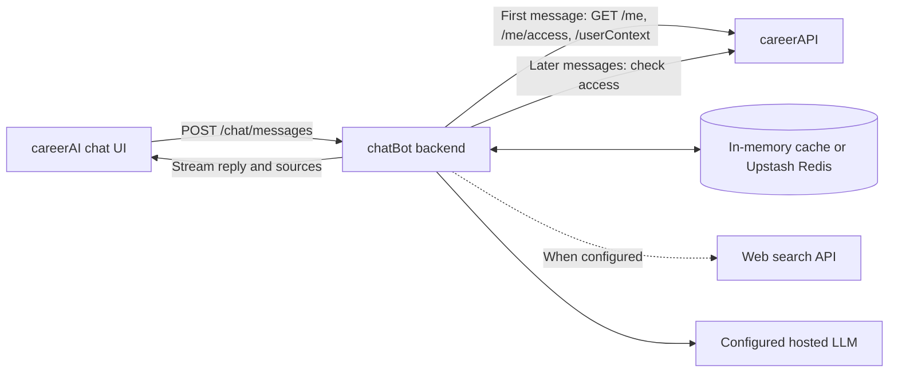

# Personalised AI Career Chat — Technical Design

## Features

The chatbot will answer career and education questions using the student's onboarding profile and career quiz results. When Brave is configured, it will search the web for current information and show clickable sources. Until then, it will say when it cannot verify a current fact. Replies will stream into the existing AI Chat UI in `careerAI/pages/app.html`.

Chat messages will remain in browser memory for the current page session. Reloading, logging out, or selecting **Clear Chat** will clear them. No conversation transcripts will be saved across sessions.

## Architecture

`chatBot` uses the student's forwarded session cookie to call `GET /me` and `GET /me/access`. It obtains the authenticated email from `/me`, then calls `GET /userContext?email=<encoded email>` with a server-side bearer token. It checks that the returned email matches. The response may include a null profile, root-level career matches, and contest scores. Only guidance data enters the LLM context; email, full name, static salary estimates, contest IDs, and timestamps stay out.

On the **first user message**, `chatBot` will fetch `userContext` and store that snapshot in the selected cache: **process-local memory by default**, or a separate managed Upstash Redis service when configured. The cache key will be tied to the authenticated student session and a browser-generated conversation ID. Upstash is optional; the profile will not be stored in the frontend.

The profile snapshot will **remain unchanged throughout that chat**. An inactivity expiry will remove abandoned snapshots to limit data retention; activity will renew it. This expiry is for cleanup, not profile freshness. If a snapshot disappears, the UI will start a new chat rather than silently change the context of an existing one. Later messages will check that the student is still logged in and has paid access, without fetching `userContext` again.

The browser will send bounded recent chat turns with each request. `chatBot` will not store transcripts in either cache. A server setting will select one hosted LLM provider and model from Groq, Gemini, or Omniroute.

## Web search and RAG

**When enabled, web search is the RAG component.** For questions requiring fresh facts, `chatBot` will retrieve relevant web content, pass it to the LLM as grounding material, and return source links with the answer. A dedicated search API keeps this behavior consistent across LLM providers.

The structured student profile comes directly from `careerAPI`. It does **not** need embeddings or a vector database.

## Guardrails and verification

The backend will validate input size, rate limit requests, enforce timeouts, and treat chat history, profile text, and web results as untrusted data. The UI will safely render streamed text and validate source links. If search is unconfigured or fails, the assistant will say it could not verify current facts. The in-memory cache requires a single running process and loses snapshots on restart.

Verification will cover first-message context loading, reuse of the fixed snapshot, inactivity cleanup, lost login or paid access, web citations, streaming failures, and Clear Chat.
